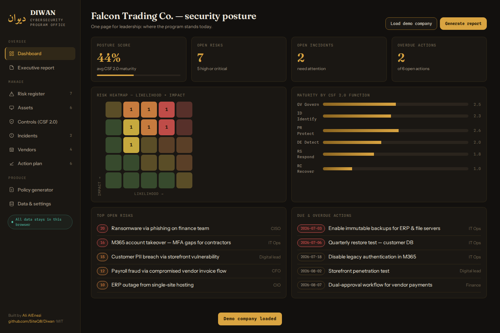
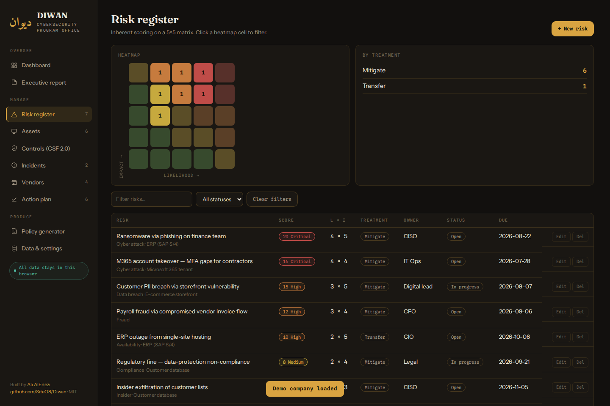
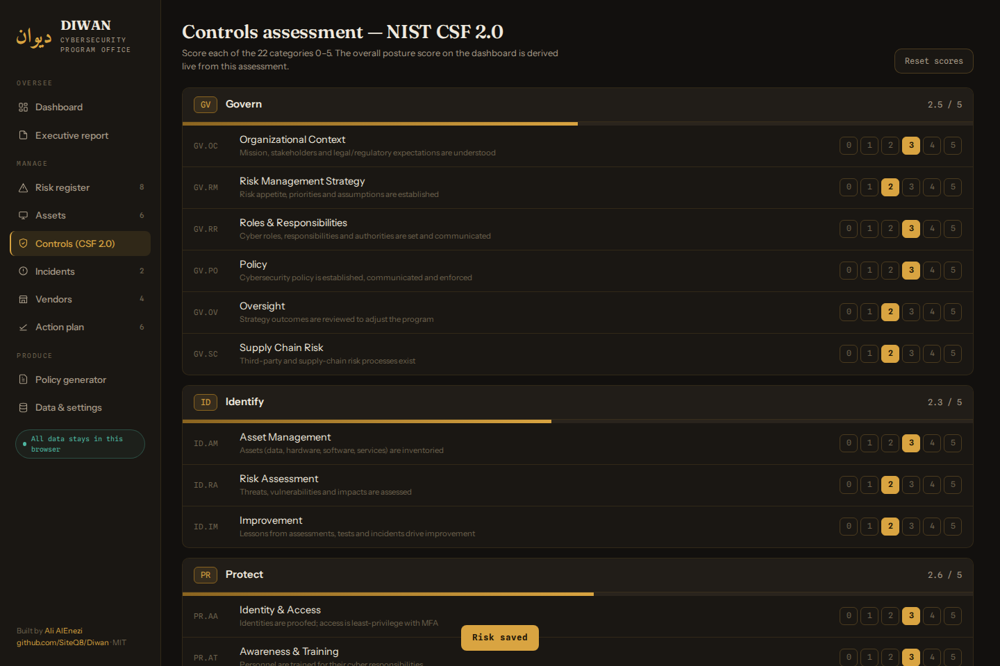
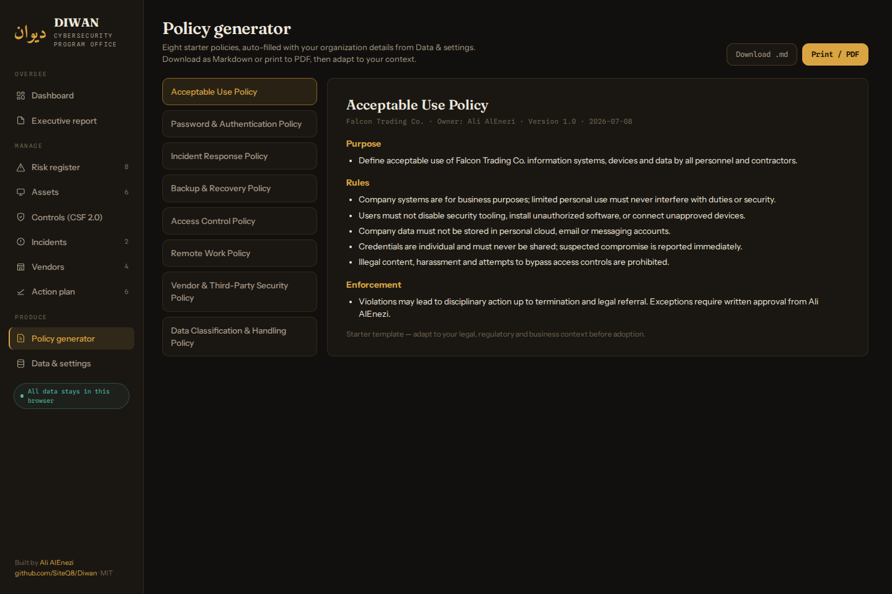
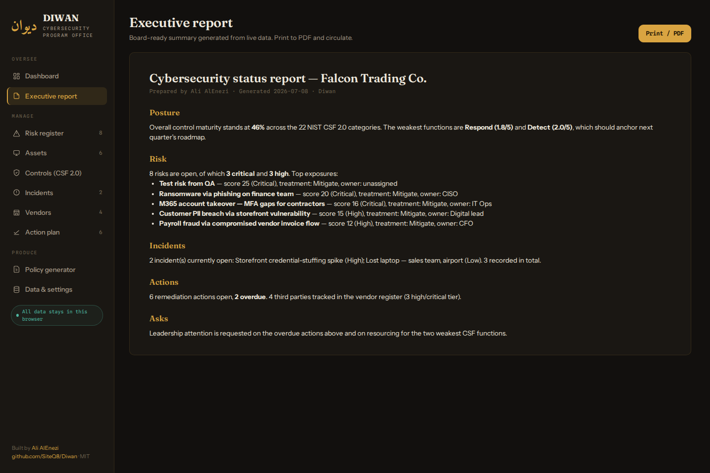

# Diwan · ديوان

**The cybersecurity program office every company should have — in a single file.**

*Diwan* (ديوان) is the historical Arabic word for the administrative registry of governance. This Diwan is exactly that for your security program: one place to run risk, assets, controls, incidents, vendors, actions, policies and executive reporting — with **no backend, no account, no telemetry**. Everything lives in your browser and exports to a single JSON file.

🔗 **Live app:** https://siteq8.github.io/Diwan/ — press **Load demo company** to explore with realistic data.

## Who it's for

The thousands of companies where "the security program" is one person with a spreadsheet: SMEs, startups, subsidiaries, school districts, non-profits — anyone who needs the discipline of a GRC platform without the six-figure license. It's also a clean sandbox for consultants and a teaching tool for building a program from zero.

## Nine modules, one file

| Module | What it does |
|---|---|
| **Dashboard** | Live posture score, open risks/incidents/overdue actions, mini heatmap, maturity bars by CSF function |
| **Risk register** | 5×5 likelihood × impact scoring with an interactive heatmap — click any cell to filter; treatment, owner, status, due date |
| **Asset inventory** | Systems, data, SaaS, fleets and facilities with owners and criticality |
| **Controls (NIST CSF 2.0)** | Score all 22 categories 0–5 on a maturity scale; the posture score is derived live |
| **Incident log** | Severity, status (open → contained → resolved), lead, timeline notes |
| **Vendor register** | Third parties tiered by risk and data access, with review dates |
| **Action plan** | The living POA&M — every decision becomes an action with an owner and a date; overdue items are flagged everywhere |
| **Policy generator** | 8 starter policies (AUP, passwords/MFA, incident response, backup, access control, remote work, vendor security, data classification) auto-filled with your org details; download as Markdown or print |
| **Executive report** | Board-ready status report generated from live data: posture, weakest functions, top risks, incidents, asks — print to PDF |

## More screenshots

| Controls assessment | Policy generator | Executive report |
|---|---|---|
|  |  |  |

## Data model & privacy

- **Storage:** everything is kept in `localStorage` in *your* browser. Nothing is transmitted anywhere, ever. The app works fully offline once loaded.
- **Backup / portability:** *Data & settings → Export JSON backup* produces one portable file containing the whole program. Import it on another machine, or hand it to your auditor.
- **Caveat:** browser storage is per-browser and can be cleared by the user or OS — treat the JSON export as your system of record and back it up on your schedule.

## Getting started

1. Open the [live app](https://siteq8.github.io/Diwan/) (or clone and open `index.html` — no build step).
2. Set your organization name and security lead under **Data & settings**.
3. Inventory your top 10 assets, add your top 10 risks, score the 22 CSF categories honestly.
4. Print the **Executive report** — you now have a defensible security program snapshot.

## Design notes

Single-file vanilla HTML/CSS/JS. No frameworks, no build, no dependencies beyond Google Fonts. Typography: Fraunces / Instrument Sans / Spline Sans Mono, with an Amiri ديوان wordmark. The maturity scale follows the common 0–5 CMM convention; risk bands follow the standard 5×5 convention (1–4 Low, 5–9 Medium, 10–15 High, 16–25 Critical).

## Disclaimer

Diwan structures your program; it doesn't replace professional judgment. Policy templates are starting points — adapt them to your legal, regulatory and business context before adoption.

## Author

**Ali AlEnezi** — [3li.info](https://3li.info) · [@SiteQ8](https://github.com/SiteQ8)

Sister projects: [Ghirbal](https://siteq8.github.io/Ghirbal/) (IOC sieve) · [NCA-ECC-Crosswalk](https://siteq8.github.io/NCA-ECC-Crosswalk/) (framework mapping) · [LLM-DFIR](https://siteq8.github.io/LLM-DFIR)

MIT License
